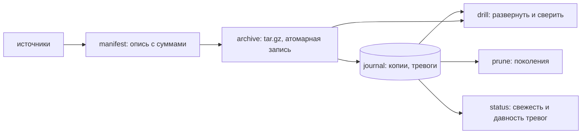

# backup-drill — резервные копии, проверенные восстановлением

Копия, которую ни разу не разворачивали, — это не резервная копия, а надежда. Архив мог обрезаться на середине, диск мог тихо испортить пару байт, опись могла не совпасть с содержимым. Узнать об этом в день аварии — худший из возможных вариантов.

Здесь копирование и проверка — одно целое. У каждой копии есть опись с контрольной суммой каждого файла, а «учебная тревога» разворачивает копию во временную папку и сверяет файлы побайтово. Пока тревога не прошла, состояние задания честно говорит: «это ещё не резервная копия».

```text
$ drill demo

Данные: 4 файлов, 177 Б.

Копии:
№  Задание    Когда        Возраст      Файлов  Архив  Состояние
3  документы  12.09 17:37  только что        4  492 Б  на месте
2  документы  11.09 17:37  1 дн. назад       3  418 Б  на месте

+ Тревога по копии №3 «документы»: проверено файлов: 4 (0.03 с)
! Тревога по копии №2 «документы»: сумма архива не совпадает с журналом (0.00 с)

Быстрая проверка сумм: №3 — в порядке, №2 — не совпала, №1 — в порядке

Ротация: оставлено 2, удалено 1.
Удалена копия №1 от 10.09

Состояние заданий:
Задание    Копий  Последняя   Размер     Тревога
документы      2  только что  492 Б   только что

Все задания в порядке: копии свежие, тревоги проходят.
```

Вторая копия в этой демонстрации испорчена намеренно: в конец архива дописаны несколько байт. Быстрая проверка сумм и учебная тревога замечают это сразу, хотя файл на месте и открывается.

## Что внутри

| Свойство | Как сделано |
|---|---|
| Опись | у каждого файла в копии записаны размер, время и SHA-256; опись лежит рядом с архивом |
| Учебная тревога | копия разворачивается во временную папку, опись пересчитывается и сравнивается: не хватает / изменилось / лишнее |
| Быстрая проверка | сумма архива целиком — дешёвая проверка, которую можно гонять хоть каждый час |
| Атомарность | архив пишется во временный файл и переносится одним движением: прерванная копия не выглядит готовой |
| Безопасная распаковка | фильтр `data`: запись вида `../../файл` внутри архива не выйдет за пределы папки |
| Ротация | по поколениям: столько-то дневных, недельных и месячных копий; остальное удаляется вместе с файлами |
| Журнал | SQLite: копии, тревоги и восстановления — на вопрос «когда последний раз проверяли» есть ответ |
| Состояние | если успешной тревоги не было дольше заданного срока, `drill status` говорит об этом первой строкой |

## Как запустить

```bash
uv sync
uv run drill demo                                  # весь сценарий: копии, тревога, порча архива, ротация
uv run drill backup                                # сделать копии по всем заданиям
uv run drill verify                                # быстрая проверка сумм; код возврата 1, если не сходится
uv run drill rehearse                              # учебная тревога по последней копии
uv run drill rehearse --copy 7                     # или по конкретной
uv run drill restore --copy 7 --to /куда/развернуть
uv run drill prune                                 # ротация по поколениям
uv run drill list                                  # копии и тревоги
uv run drill status                                # главное: свежесть копий и давность тревог
```

Настройки — один файл (пример в `examples/drill.toml`):

```toml
[storage]
folder = "копии"
drill_every_days = 7          # дольше без успешной тревоги — повод для беспокойства

[[job]]
name = "документы"
sources = ["данные/документы"]
excludes = ["*.tmp", "~$*", "Thumbs.db"]
keep_daily = 7
keep_weekly = 4
keep_monthly = 6
```

Ночью — копия, по выходным — тревога; оба возвращают ненулевой код при неудаче, так что письмо от планировщика придёт само:

```bat
schtasks /create /tn "Копии"  /tr "drill backup"   /sc daily  /st 02:00
schtasks /create /tn "Тревога" /tr "drill rehearse" /sc weekly /d SUN /st 03:00
```

## Как устроено



| Модуль | Ответственность |
|---|---|
| `config.py` | задания, исключения, сроки хранения, срок между тревогами |
| `manifest.py` | обход источников, контрольные суммы, сравнение описей |
| `archive.py` | запись архива, проверка суммы, безопасная распаковка |
| `journal.py` | SQLite: копии, тревоги, восстановления |
| `runner.py` | копия, тревога, восстановление, ротация |
| `report.py`, `cli.py`, `demo.py` | таблицы, команды, демонстрация |

## Что учтено такого, чего обычно не делают

| Ловушка | Чем оборачивается | Что здесь |
|---|---|---|
| Копия не проверяется | о непригодности архива узнают в день аварии | учебная тревога с посимвольной сверкой описи и записью результата |
| Прерванная копия выглядит готовой | ротация удалит настоящую копию, оставив огрызок | архив пишется во временный файл и переносится одним движением |
| Распаковка чужого архива | запись `../../` внутри архива перезапишет файл вне папки | распаковка с фильтром `data`, на это есть отдельный тест |
| «Свежая копия» без даты проверки | никто не знает, когда последний раз проверяли | в состоянии заданий отдельная колонка: когда была последняя успешная тревога |
| Ротация «по количеству» | месяц ежедневных копий вытесняет всю историю | поколения: день, неделя, месяц — по отдельности |
| Два источника с одинаковым именем | в архиве они молча перекрывают друг друга | настройки такого не пропускают: ошибка при разборе файла |

## Как проверялось

- `ruff format`, `ruff check` (E, F, W, I, B, UP, S — bandit, C4, SIM, PT, RUF, DTZ) и `mypy --strict` — без замечаний.
- `pytest` — 57 тестов за 2,3 с: разбор настроек и десять видов ошибок в них, сбор описи (вложенные папки, исключения по имени и по пути, одиночный файл), сравнение описей (пропало, изменилось, добавилось), запись и распаковка архива, порча архива, попытка выхода за пределы папки при распаковке, журнал, все ветки тревоги (испорченный архив, пропавший архив, испорченная опись), восстановление, ротация по дневным и месячным поколениям, команды и коды возврата.
- Демонстрация (`drill demo`) прогоняется тестом целиком: она обязана поймать испорченный архив, иначе сборка падает.
- Проверено на Windows, где и писалось: пути с кириллицей, вложенные папки, файлы с русскими именами внутри архива.

### Не проверялось

- Объём: десятки файлов и килобайты. На сотнях гигабайт не проверялось ни время работы, ни поведение при нехватке места на диске.
- Копии не шифруются. Для настоящих данных это обязательный следующий шаг, и вместе с ним появляется вопрос хранения ключа — здесь он не решён.
- Копии лежат на том же диске. Правило «три копии, два носителя, одна вне площадки» этим проектом не выполняется: отправку в другое хранилище я не делал и не проверял.
- Инкрементальных копий нет: каждая копия полная. Для больших данных это дорого.
- Файлы, которые меняются во время копирования (открытая база, растущий журнал), попадут в архив в противоречивом виде: снимков файловой системы проект не делает.
- Восстановление проверялось только на этой машине. Перенос архива на другую машину и распаковку там я не проверял.

## Структура

```text
src/drill/   config, manifest, archive, journal, runner, report, cli, demo
tests/       настройки, опись, архив, журнал, операции, команды
examples/    drill.toml — два задания с разными сроками хранения
```
